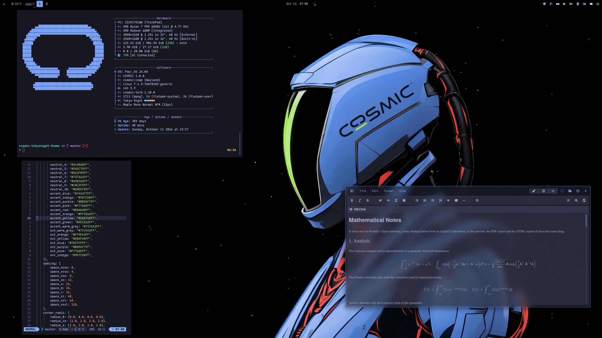
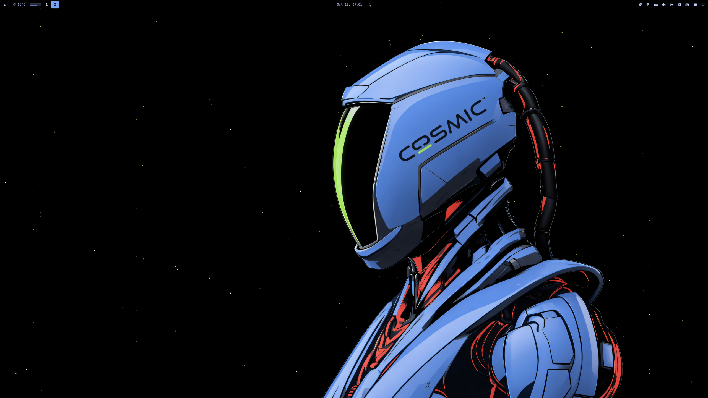

<div align="center">

# COSMIC · Tokyo Night

Pop!_OS 24.04 on COSMIC in Tokyo Night navy, blue and lime: desktop, terminal,
shell, editor, Firefox, cursor, wallpapers.


</div>

---


## Palette

Tokyo Night Dark, the low-contrast navy palette from the
[VS Code theme](https://github.com/tokyo-night/tokyo-night-vscode-theme) of the
same name. Contrast is measured on the window background `#1A1B26`.

| Role | Color | Hex | Contrast |
|------|-------|-----|----------|
| Background |  Dark navy | `#1A1B26` | |
| Containers |  Storm / Highlight | `#24283B` / `#292E42` | |
| Text |  Soft white | `#C0CAF5` | 10.6:1 |
| Accent |  Blue | `#7AA2F7` | 6.8:1 |
| Cyan |  Sky | `#7DCFFF` | 10.0:1 |
| Purple |  Lavender | `#BB9AF7` | 7.4:1 |
| Success |  Green | `#9ECE6A` | 9.4:1 |
| Warning |  Amber | `#E0AF68` | 8.5:1 |
| Orange |  Orange | `#FF9E64` | 8.4:1 |
| Error |  Rose | `#F7768E` | 6.5:1 |
| Muted |  Dark 5 | `#737AA2` | 4.1:1 |
| Comment |  Comment | `#565F89` | 2.8:1 |

Comments sit deliberately low, as in the original theme. Everything you read
as text is 6.5:1 or better.

### Cosmic Night (Firefox only)

Firefox gets its own palette, sampled from the astronaut wallpaper with
k-means and tuned until every text pair clears WCAG AA. It runs darker and
cooler than the rest of the rice.

| Role | Color | Hex |
|------|-------|-----|
| Background |  True black | `#000000` |
| Panels |  Shadow | `#171B23` |
| Blue |  Armor | `#79A3F7` |
| Lime |  Visor | `#A8EC61` |
| Red |  Under-suit | `#E04C5D` |
| Grey |  Mech detail | `#3A3946` |
| Foreground |  Soft white | `#C3D0F5` |

---

## Repo Structure

```
.
├── assets
│   ├── cursors/                 # cursor previews
│   ├── screenshot.png           # README screenshot
│   └── wallpaper.png            # the astronaut on the bare desktop
├── backgrounds/                 # wallpapers, tokyonight-<subject>.png (see Icons and wallpaper)
├── btop
│   └── TokyoNight.theme         # btop colour theme
├── claude-desktop
│   ├── cosmic-tokyo-night.jsonc # Claude Desktop theme (claude-desktop-extra), dark + light
│   └── install.sh
├── cosmic
│   ├── TokyoNight.ron           # COSMIC Appearance import (Dark)
│   ├── config/                  # baseline settings: fonts, icons, terminal look
│   └── install.sh
├── cosmic-term
│   └── TokyoNight-term.ron      # COSMIC Terminal colour scheme
├── cursors
│   ├── Oxygen-TokyoNight-*/      # cursor themes, one per icon colour, patched for COSMIC apps
│   ├── install.sh
│   ├── uninstall.sh
│   └── README.md
├── docs
│   └── showcase.md              # the rice describing itself, for the Postilla pane of the screenshot
├── icons
│   └── install.sh               # Cosmic-TokyoNight icon pack from cosmic-icon-themes
├── fastfetch
│   ├── config.jsonc             # blue / comment-grey fastfetch config
│   ├── cosmic.txt               # COSMIC logo, coloured by the config
│   └── install.sh
├── firefox                      # Cosmic Night browser theme
│   ├── theme
│   │   ├── manifest.json        # WebExtension theme, 40 colour keys
│   │   └── icons                # 32 / 48 / 64 / 96 / 128
│   ├── chrome
│   │   ├── userChrome.css       # browser UI: rounded corners, menu borders
│   │   └── userContent.css      # new tab page accent colour
│   ├── install.sh               # copies chrome/ into the default profile
│   └── README.md
├── lsd
│   ├── config.yaml              # theme: custom
│   ├── colors.yaml              # permission / size / date / git columns
│   └── install.sh
├── nvim                         # Neovim colorscheme, LazyVim spec, RON syntax, install.sh
├── telegram
│   ├── colors.tdesktop-theme    # Telegram Desktop colour scheme (source)
│   ├── cosmic-tokyonight.tdesktop-theme  # built theme, open this in Telegram
│   └── build.sh                 # rebuilds it, optionally with a wallpaper
├── scripts
│   ├── update_system.sh         # nala + flatpak, Tokyo Night ANSI
│   └── switch.sh                # make this the active rice (see Switching rice)
├── zsh
│   ├── tokyonight.zsh           # LS_COLORS, highlighting colours, aliases, starship
│   └── install.sh
├── LICENSE
└── README.md
```

---

## COSMIC Desktop

Settings → Desktop → Appearance → **Dark** → **Import** → `cosmic/TokyoNight.ron`

The whole palette is Tokyo Night, in the same format as the DarkGold baseline:
background `#1A1B26`, containers `#24283B` / `#292E42`, navy neutrals from
`#3B4261` to `#C0CAF5` (so frosted glass tints navy, not grey), accent blue
`#7AA2F7`, success `#9ECE6A`, warning `#E0AF68`, error `#F7768E`. Text tint
is pinned to `#C7D1FD`, a touch brighter than Tokyo Night's `#C0CAF5` so it
stays crisp on the glass.

Frosted glass is on at `frosted: Low` with an opacity table of 0.66 to 0.96,
tinted with the palette's middle neutral `#545C7E`, the same glass as every
other rice. It covers windows, panel, applets and system UI (maximized apps
stay solid), and corners are squared (`radius_*: 2.0`), the same as the
DarkGold baseline.
Adjust it on Appearance → Style → Frosted glass after import; those sliders
survive a theme switch. Export from Appearance if you tweak it so you do not
lose the changes.

**Known COSMIC bug:** moving the frosted glass opacity / thickness sliders can
reset `text_tint` to `#FFFFFF`. If your text turns white, re-import
`cosmic/TokyoNight.ron`; it carries the tint. Upstream fix proposed in
[libcosmic#1450](https://github.com/pop-os/libcosmic/pull/1450), not merged.

### Baseline settings

`cosmic/config/` holds the settings that make up the look and rarely change
(panel, dock, applets and shortcuts are left out on purpose):

| Where | Setting |
|-------|---------|
| Fonts | Interface `Maple Normal UI`, monospace `Maple Mono Normal NFM` |
| Icons | Cosmic-TokyoNight-Blue |
| Windows | Minimize / maximize buttons hidden, theme applied to GNOME apps |
| Terminal | Maple Mono 15 (weights 500 / bold 800 / dim 300), 77% opacity, no header bar, Tokyo Night |

Install the [Maple fonts](https://github.com/subframe7536/maple-font) and the
Cosmic-TokyoNight icons (see Icons below) and import the terminal scheme first, then:

```bash
./cosmic/install.sh
```

It backs up each file it replaces to `*.bak` and COSMIC applies it live.

---

## COSMIC Terminal

The desktop `.ron` does not colour ANSI text.

1. COSMIC Terminal → **View → Color schemes…** (not Settings → Appearance)
2. Dark tab → **Import** → `cosmic-term/TokyoNight-term.ron`
3. View → Settings → Appearance → Color scheme (dark) → **Tokyo Night**

If a profile is set as default, set the scheme on that profile too or the
dropdown will look like it did nothing.

---

## Firefox

Two layers:

1. **Theme (colours):** install
   **[Cosmic Night on addons.mozilla.org](https://addons.mozilla.org/en-US/firefox/addon/cosmic-night/)**.
   This is the main look: a true-black theme whose palette comes from the
   astronaut wallpaper rather than from Tokyo Night (see the second table
   under Palette). Blue chrome, a lime focus accent, red for alerts.
2. **Stylesheets (optional):** `firefox/chrome/` adds rounded corners, menu
   borders and the new tab accent on top of the theme:

```bash
./firefox/install.sh
```

Fully restart Firefox afterward: `userChrome.css` is only parsed at startup.

Full details and CSS gotchas in [`firefox/README.md`](firefox/README.md).

---

## Claude Desktop

For the unofficial [claude-desktop-extra](https://github.com/patrickjaja/claude-desktop-extra)
Linux build. `claude-desktop/cosmic-tokyo-night.jsonc` is one theme with both halves:
Tokyo Night in dark mode and Tokyo Day in light mode, so Claude's own
Settings → Appearance toggle switches between the two rices.
Colours come from `cosmic/*.ron`, contrast-checked (text and button text
4.5:1, accents 3:1).

```bash
./claude-desktop/install.sh
```

It copies the file into `~/.config/Claude/themes.d/`. Then press
<kbd>Ctrl</kbd>+<kbd>Shift</kbd>+<kbd>T</kbd> in Claude Desktop and pick **cosmic-tokyo-night**.

The same file ships in [`cosmic-tokyoday-theme`](https://github.com/atraxsrc/cosmic-tokyoday-theme),
so installing from either repo gives the same theme.

---

## Telegram

`telegram/cosmic-tokyonight.tdesktop-theme` is a Telegram Desktop theme: dark
navy chat list and background, storm incoming and dark-green outgoing bubbles,
blue for the accent, links, unread badges and buttons (with navy text on
them), green for online status and read ticks. Group member names use the
rice's terminal colours. Text and badge colours are contrast-checked at 4.5:1
or better, except disabled menu items.

Settings → Chat Settings → Chat wallpaper → **Choose from file** →
`telegram/cosmic-tokyonight.tdesktop-theme` → **Apply this theme**.

The colours live in `telegram/colors.tdesktop-theme`, which is plain text;
`build.sh` zips it with the chat background into the `.tdesktop-theme`. The
background is the plain window colour; to put a wallpaper behind the chat instead
(ImageMagick re-encodes it to a 2560px JPEG, Telegram caps theme files at 5 MB):

```bash
./telegram/build.sh --wallpaper backgrounds/tokyonight-anime.png
```

Built against Telegram Desktop 7.3.1. Calls, group calls, statistics charts and
premium badges keep Telegram's own colours.

Telegram has no dark / light pairing, so Tokyo Day, the light half, ships its
own theme.

---

## Scripts

### `update_system.sh`

nala + flatpak updater with Tokyo Night coloured output: nala package updates
(apt fallback), Flatpak updates, a Snap function that is off by default
(uncomment `update_snap` in `main`), and a runtime timer.

```bash
chmod +x scripts/update_system.sh
./scripts/update_system.sh
```

Don't run the whole script with `sudo`: `flatpak update` would then only
update system-wide installs and skip your per-user Flatpaks.

### `switch.sh`

Makes this the active rice, coming from any other `cosmic-*-theme` rice. See
[Switching rice](#switching-rice).

```bash
./scripts/switch.sh
```

---

## Terminal extras

Need a [Nerd Font](https://www.nerdfonts.com/) in the terminal for the icons
(Maple Mono NFM in the baseline above).

### zsh

`zsh/tokyonight.zsh` is the rice part of the shell only: `LS_COLORS` (also
used by lsd for file names and by the completion menu), Tokyo Night colours
for zsh-autosuggestions and zsh-syntax-highlighting, lsd / bat / nvim aliases
and the starship prompt. Your own `~/.zshrc` stays private and sources it.

Needs zsh + [oh-my-zsh](https://ohmyz.sh/). `install.sh` clones the two
plugins if missing and appends one `source` line to `~/.zshrc` (backup in
`~/.zshrc.bak`):

```bash
./zsh/install.sh
exec zsh
```

In `~/.zshrc` keep `ZSH_THEME=""` and
`plugins=(git sudo zsh-autosuggestions zsh-syntax-highlighting)`.

### lsd

File names are coloured by `LS_COLORS` from `zsh/tokyonight.zsh`;
`lsd/colors.yaml` colours the other columns with the 256-colour codes nearest
the palette (149 green, 111 blue, 179 yellow, 210 red, 141 purple,
60 comment). lsd 1.0.0 does not accept `#hex` there.

```bash
./lsd/install.sh
lsd -l
```

### fastfetch

COSMIC logo in Tokyo Night blue, Hardware / Software / Age boxes in comment
grey with purple titles, the same layout as every other rice. `install.sh`
backs up any existing `~/.config/fastfetch/config.jsonc` to
`config.jsonc.bak`.

```bash
./fastfetch/install.sh
fastfetch
```

### Neovim

`nvim/` carries the rice into Neovim: a dependency-free colorscheme built from
the palette (`nvim/colors/tokyonight.lua`), a LazyVim spec that selects it and
makes sure the treesitter parsers for the files in this repo are installed
(`nvim/lua/plugins/tokyonight.lua`), and a small RON syntax file so
`cosmic/*.ron` is coloured even before the parser exists. `:terminal` inside
Neovim uses the Tokyo Night scheme.

```bash
./nvim/install.sh
# restart nvim; LazyVim switches to the tokyonight colorscheme
```

Without LazyVim, copy `nvim/colors/tokyonight.lua` to `~/.config/nvim/colors/`
and run `:colorscheme tokyonight`.

### btop

`btop/TokyoNight.theme`: navy background, blue titles, green → yellow → red
meters.

```bash
mkdir -p ~/.config/btop/themes
cp btop/TokyoNight.theme ~/.config/btop/themes/
# btop → Esc → Options → Color theme → TokyoNight
```

---

## Cursor

**Oxygen** cursors recoloured to the icon colours, one per folder colour of the
Cosmic-TokyoNight icon pack: **Blue** (default), **Purple**, **Green**, **Dark**. Patched with the cursor
names COSMIC apps ask for. COSMIC has no cursor picker yet, so the script sets it:

```bash
./cursors/install.sh                      # Blue
./cursors/install.sh --variant Purple    # or another, see --list
reboot
```

Previews, what the script touches, how to undo it and how the colours are made:
[`cursors/README.md`](cursors/README.md).

---

## Icons and wallpaper

Icons: **Cosmic-TokyoNight**, the [Kanagawa icons](https://github.com/Fausto-Korpsvart/Kanagawa-GKT-Theme/tree/main/icons/Kanagawa)
by Fausto Korpsvart recolored to this palette in
[cosmic-icon-themes](https://github.com/atraxsrc/cosmic-icon-themes). Folders come in
four colors: **Blue** `#7AA2F7` (default), **Purple** `#BB9AF7`, **Green** `#9ECE6A` and **Dark** `#292E42` with blue symbols.


```bash
./icons/install.sh                   # Blue folders
./icons/install.sh --variant Purple  # or Green, Dark
```

It downloads the pack from the latest cosmic-icon-themes release, checks its SHA256,
installs it to `~/.local/share/icons/` and sets it as the COSMIC icon theme.
Restart open apps afterwards (Files caches icons per window).
Add `--system` to install to `/usr/share/icons` instead, for every user and the
login screen (asks for sudo); `--user` is the default.

Wallpapers ship in [`backgrounds/`](backgrounds/), named `tokyonight-<subject>.png`:
the thirteen subjects every dark rice has, rendered in Tokyo Night blue and yellow:
the Harbor Dark reaper and Hyundai blueprint, the COSMIC astronaut, the samurai,
sushi switch, geisha, JS mug and neon street from the Tokyo Night set, The Greek
eagle and ink portrait, and three new scenes: city, panel and tower.
Plus the astronaut on black, `tokyonight-cosmic-astronaut-black.png`: the one in the
screenshot, and the image the Firefox palette was sampled from.
The subjects come from [HANCORE-linux](https://github.com/HANCORE-linux) (MIT) and
[cool-wallpapers](https://github.com/atraxsrc/cool-wallpapers); each was rendered again in this palette, then upscaled.
The big Tokyo Night set stays in cool-wallpapers, folder
[`tokyonight/`](https://github.com/atraxsrc/cool-wallpapers/tree/main/tokyonight).

Settings → Wallpaper → Add image → a file from `backgrounds/`.



---

## Setup

Prerequisites: [nala](https://gitlab.com/volian/nala) for the update script
and a recent fastfetch.

```bash
sudo apt install nala
sudo add-apt-repository ppa:zhangsongcui3371/fastfetch
sudo nala update && sudo nala install fastfetch
```

Then:

```bash
git clone https://github.com/atraxsrc/cosmic-tokyonight-theme.git
cd cosmic-tokyonight-theme

# desktop
# Settings → Appearance → Dark → Import cosmic/TokyoNight.ron

# terminal
# View → Color schemes → Import cosmic-term/TokyoNight-term.ron

# firefox stylesheets (optional)
./firefox/install.sh

# claude desktop (claude-desktop-extra), then Ctrl+Shift+T
./claude-desktop/install.sh

# telegram desktop
# Settings → Chat Settings → Chat wallpaper → Choose from file → telegram/cosmic-tokyonight.tdesktop-theme

# shell + terminal tools (see Terminal extras above)
./zsh/install.sh
./lsd/install.sh
./fastfetch/install.sh
./nvim/install.sh
mkdir -p ~/.config/btop/themes && cp btop/TokyoNight.theme ~/.config/btop/themes/

# wallpaper
# Settings → Wallpaper → Add image → a file from backgrounds/ (see Icons and wallpaper above)

./cursors/install.sh                # cursor, Blue (see Cursor above), then reboot
./icons/install.sh                  # icons (see Icons above)
# Maple fonts (https://github.com/subframe7536/maple-font), then
# fonts, icons, terminal look from cosmic/config/
./cosmic/install.sh
```

---

## Switching rice

The installers replace what they own (with a `*.bak` copy), but some things
pile up instead: shell layers in `~/.zshrc`, LazyVim specs, the updater link and
btop's theme setting. `scripts/switch.sh` makes Tokyo Night the active rice, coming
from any other `cosmic-*-theme` rice, and tidies those up. Every rice repo ships
the same script.

```bash
./scripts/switch.sh               # switch, icons included
./scripts/switch.sh --keep-icons  # leave the current icon theme alone
```

It backs up every file it replaces, then:

- copies `cosmic/config/` (fonts, terminal look, icons) and turns dark mode on.
  The terminal scheme and icon theme are only replaced when the current one is
  not already a Tokyo Night variant, so a dimmer text variant or another icon colour
  survives. Icons stay as they are until `./icons/install.sh` has run.
- runs the fastfetch, lsd, Neovim and Claude Desktop installers and sets
  btop's `color_theme`
- moves every other rice's LazyVim spec from `~/.config/nvim/lua/plugins/` to
  `~/.config/nvim/rice-off/` (LazyVim loads every spec there and the last
  colorscheme wins); your own specs stay
- comments out every other rice's `source` line in `~/.zshrc`, and
  cosmic-ricing's `ricing/zsh/colors.zsh`, then uncomments Tokyo Night's or adds it
- points `~/update_system.sh` at this repo's updater
- installs the Firefox userChrome / userContent

The GUI steps it cannot do are printed at the end:

1. Settings → Desktop → Appearance → Dark → Import `cosmic/TokyoNight.ron`
2. COSMIC Terminal → View → Color schemes → Dark tab → Import `cosmic-term/TokyoNight-term.ron`
3. Firefox: disable the old rice's add-on, enable [this one](https://addons.mozilla.org/en-US/firefox/addon/cosmic-night/), restart Firefox
4. Settings → Wallpaper → a file from `backgrounds/`
5. Claude Desktop: Ctrl+Shift+T → `cosmic-tokyo-night`, Appearance → Dark
6. `exec zsh`, restart Neovim (`:Lazy clean` drops plugins only the old specs used)

Skip 1 and 2 when that slot already holds Tokyo Night. The first time on this rice,
run [Setup](#setup) once for the fonts, icons and cursor.

**Within the pair** (Tokyo Night ↔ [Tokyo Day](https://github.com/atraxsrc/cosmic-tokyoday-theme)): the two halves
sit side by side in COSMIC's Dark and Light slots and share one Claude Desktop
theme, so after the first time only the Firefox add-on and the wallpaper are
left by hand. Add `--keep-icons` to keep one icon colour across the pair.

Leaving Tokyo Night is the next rice's `./scripts/switch.sh`. `./cursors/uninstall.sh`
puts the Pop cursor back.

---

## Stack

| Tool | What it does |
|------|-------------|
| [Pop!_OS 24.04](https://pop.system76.com/) | Base OS by System76 |
| [COSMIC DE](https://system76.com/cosmic) | Desktop environment |
| [oh-my-zsh](https://ohmyz.sh/) | zsh framework + plugins |
| [lsd](https://github.com/lsd-rs/lsd) | `ls` with icons and colours |
| [fastfetch](https://github.com/fastfetch-cli/fastfetch) | System info |
| [btop](https://github.com/aristocratos/btop) | Resource monitor |
| [nala](https://gitlab.com/volian/nala) | Nicer apt frontend for the update script |
| [cosmic-icon-themes](https://github.com/atraxsrc/cosmic-icon-themes) | Icon pack (Cosmic-TokyoNight), recolored from [Kanagawa icons](https://github.com/Fausto-Korpsvart/Kanagawa-GKT-Theme/tree/main/icons/Kanagawa) |
| [Oxygen-Cursors](https://github.com/wo2ni/Oxygen-Cursors) | Cursor, recoloured to the icon colours |

## Credits

- Palette: [Tokyo Night](https://github.com/tokyo-night/tokyo-night-vscode-theme),
  the VS Code theme. This repo is a COSMIC port.
- Shared baseline (frosted glass, squared corners, fonts) from
  [cosmic-darkgold-theme](https://github.com/atraxsrc/cosmic-darkgold-theme).

## License

MIT. The cursor artwork keeps the terms of KDE's Oxygen project, see
[`cursors/README.md`](cursors/README.md).
