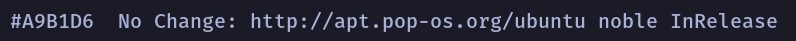
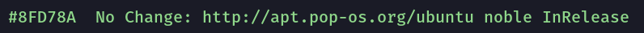
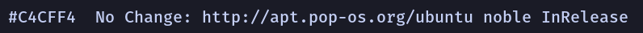

# COSMIC Terminal schemes

Colour schemes for COSMIC Terminal. The desktop `.ron` in `cosmic/` does not
colour ANSI text, so the terminal needs its own import.

1. COSMIC Terminal → **View → Color schemes…** (not Settings → Appearance)
2. **Dark** tab → **Import** → a `.ron` from this folder
3. View → Settings → Appearance → Color scheme (dark) → the scheme name

If a profile is set as default, set the scheme on that profile too or the
dropdown will look like it did nothing. `cosmic/install.sh` selects **Tokyo Night**,
so import that one at least.

Every scheme here keeps the 16 ANSI colours of Tokyo Night. Only the plain text
colour and the dim text change, so bat, lsd, starship, nala and btop look the
same whichever one you pick. The cursor stays the plain text colour  `#A9B1D6`.

The ANSI slots follow the rice: `red` is rose
 `#F93356`; `green` is green
 `#8FD78A`; `yellow` is
amber  `#E9BD64`; `blue` is
blue  `#5C9FF4`; `magenta`
is lavender  `#B974DC`;
`cyan` is sky  `#59C2C7`;
`white` is storm grey, the plain text colour
 `#A9B1D6`. Directories are
not affected: `LS_COLORS` in `zsh/tokyonight.zsh` colours them in truecolor.

## Which one

Storm grey  `#A9B1D6` is the default. The others move through Tokyo Night's own greys
and tints: calmer above it, brighter below it, for whoever finds the default
glares at night or reads too dim by day.

| Scheme | Plain text | Contrast | Also used for |
|--------|------------|----------|---------------|
| Tokyo Night Muted |  `#737AA2` | 4.1:1 | muted text |
| Tokyo Night Blue |  `#7AA2F7` | 6.8:1 | the accent |
| Tokyo Night Green |  `#8FD78A` | 10.0:1 | strings, success, the `green` slot |
| Tokyo Night Sky |  `#59C2C7` | 8.1:1 | the `cyan` slot |
| Tokyo Night Pale |  `#C4CFF4` | 11.1:1 | the bright `white` slot, the bright text colour |
| **Tokyo Night** (default) |  `#A9B1D6` | 8.1:1 | the plain text colour of the rice |

When plain text shares a colour with an ANSI slot, output in that slot stops
standing out: the accent in Tokyo Night Blue, for example, looks like plain text.
Errors and numbers stand out more against the dimmer schemes than against
storm grey.

**Bold:** `bright_foreground` ( `#C4CFF4`) only colours bold text when
`use_bright_bold` is on. The baseline config in `cosmic/config/` leaves it off,
so bold text is the plain text colour at weight 800.

Previews are rendered in Fira Mono on the terminal background  `#1A1B26`, not
taken from the terminal. In COSMIC you get Maple Mono at 77% opacity over the wallpaper, so text looks a little softer and contrast a little lower.

## Dark

**Tokyo Night** · `TokyoNight-term.ron` · storm grey  `#A9B1D6`, 8.1:1. The default.

**Tokyo Night Muted** · `TokyoNight-term-muted.ron` ·  `#737AA2`, 4.1:1. Muted text.

**Tokyo Night Blue** · `TokyoNight-term-blue.ron` ·  `#7AA2F7`, 6.8:1. The accent.

**Tokyo Night Green** · `TokyoNight-term-green.ron` ·  `#8FD78A`, 10.0:1. Strings, success, the `green` slot.

**Tokyo Night Sky** · `TokyoNight-term-sky.ron` ·  `#59C2C7`, 8.1:1. The `cyan` slot.

**Tokyo Night Pale** · `TokyoNight-term-pale.ron` ·  `#C4CFF4`, 11.1:1. The bright `white` slot, the bright text colour.

Contrast is plain text on the terminal background, WCAG 2.
